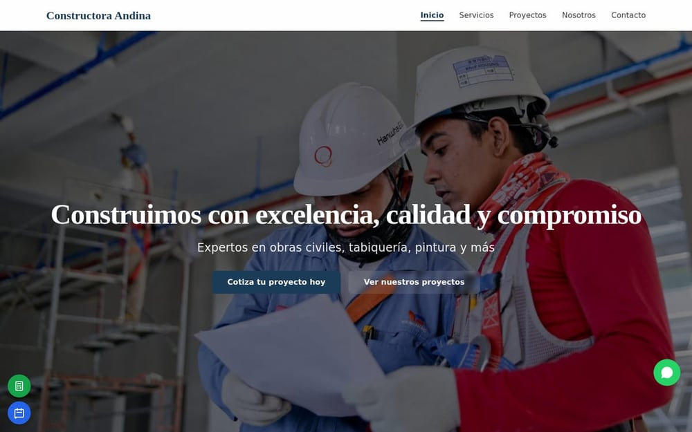
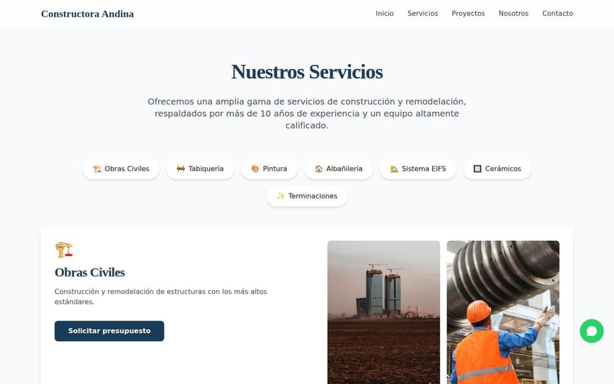
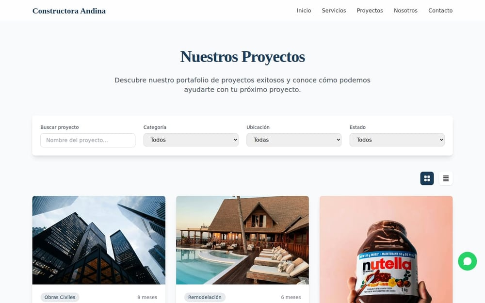
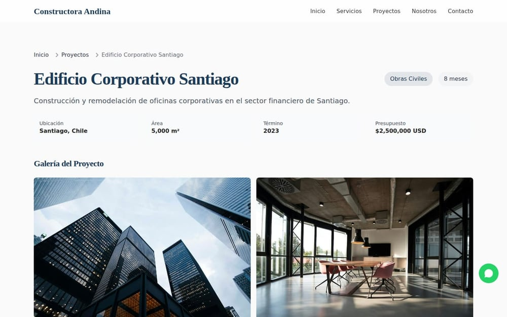
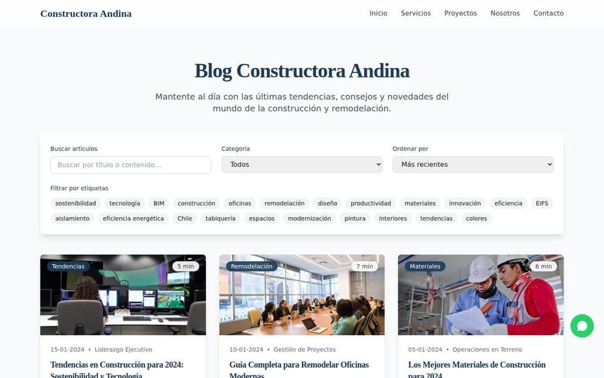
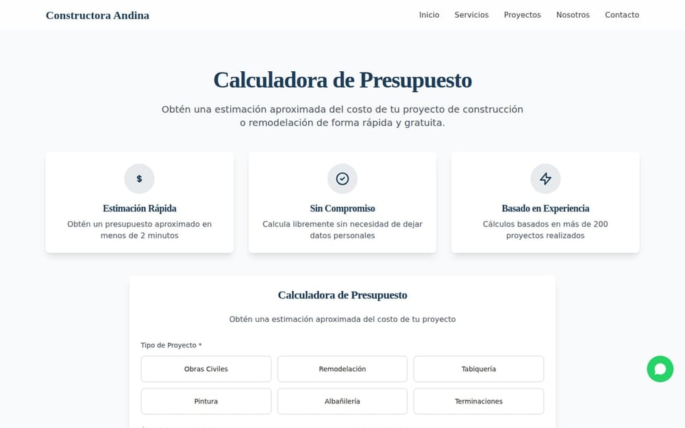
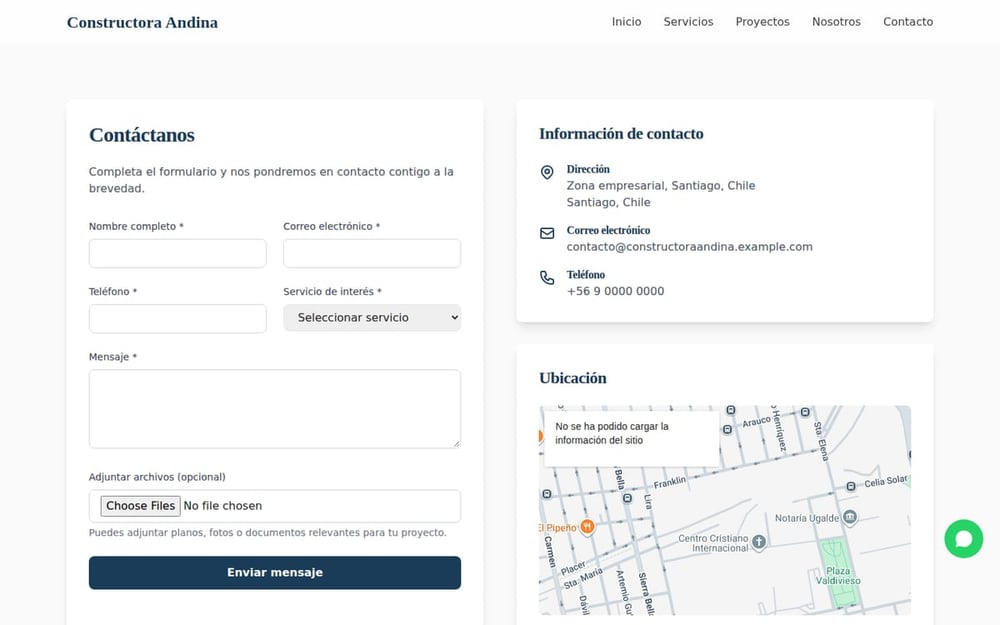
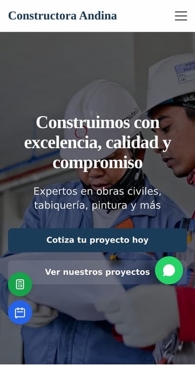
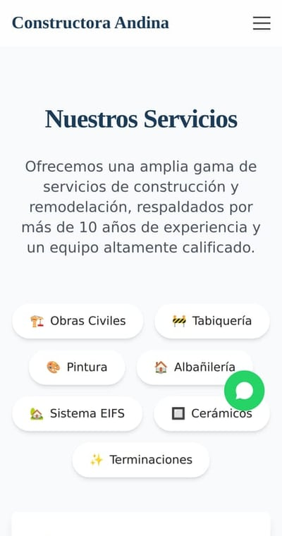
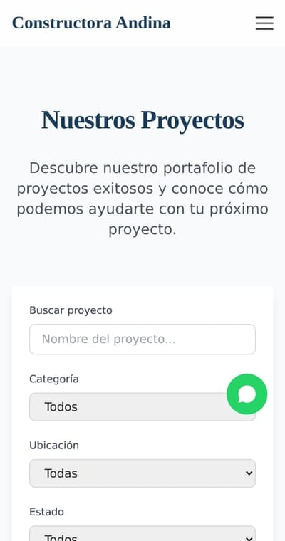

# Constructora Andina Web

> **Escaparate público.** Versión de portafolio de este producto para demostrar diseño,
> arquitectura y flujos. No incluye infraestructura, configuración ni credenciales.

**Bilingual construction company platform**

**Version:** 1.0.0 · **Year:** 2026 · **Status:** DEVELOPMENT

## Overview

A bilingual corporate web platform for a construction company built with Astro + Tailwind: lead capture, appointment booking, service pages, project portfolio, blog content, and groundwork for payments/auth with Supabase + Stripe.

## Vitrina — capturas y documentación técnica

**[`vitrina/`](vitrina/README.md)** contiene la presentación pública del proyecto: capturas reales del
sitio compilado (desktop y móvil), arquitectura, funcionalidades y ficha técnica.

| Documento | Contenido |
|---|---|
| [`vitrina/README.md`](vitrina/README.md) | Presentación, 10 capturas, qué resuelve, alcance |
| [`vitrina/docs/ARQUITECTURA.md`](vitrina/docs/ARQUITECTURA.md) | Decisiones de diseño y estructura, sin publicar código |
| [`vitrina/docs/FUNCIONALIDADES.md`](vitrina/docs/FUNCIONALIDADES.md) | Módulos y para qué existe cada uno |
| [`vitrina/docs/FICHA-TECNICA.md`](vitrina/docs/FICHA-TECNICA.md) | Stack, métricas verificadas y decisiones |

Las capturas se generan automáticamente con Playwright desde el build; no son montajes manuales.

### Galería

**Escritorio**

| <a href="vitrina/screenshots/home.jpg"></a><br><sub><b>Portada</b></sub> | <a href="vitrina/screenshots/servicios.jpg"></a><br><sub><b>Servicios</b></sub> | <a href="vitrina/screenshots/proyectos.jpg"></a><br><sub><b>Proyectos</b></sub> |
|---|---|---|
| <a href="vitrina/screenshots/proyecto-detalle.jpg"></a><br><sub><b>Detalle de proyecto</b></sub> | <a href="vitrina/screenshots/blog.jpg"></a><br><sub><b>Blog</b></sub> | <a href="vitrina/screenshots/calculadora.jpg"></a><br><sub><b>Calculadora</b></sub> |
| <a href="vitrina/screenshots/contacto.jpg"></a><br><sub><b>Contacto</b></sub> | &nbsp; | &nbsp; |

**Móvil**

| <a href="vitrina/screenshots/mobile-home.jpg"></a><br><sub><b>Móvil · Portada</b></sub> | <a href="vitrina/screenshots/mobile-servicios.jpg"></a><br><sub><b>Móvil · Servicios</b></sub> | <a href="vitrina/screenshots/mobile-proyectos.jpg"></a><br><sub><b>Móvil · Proyectos</b></sub> |
|---|---|---|

*10 capturas del build real. Cada imagen abre la versión completa; todas están en [`vitrina/screenshots/`](vitrina/screenshots).*

## Architecture

The codebase follows a component-based architecture with typed domain models and service abstractions ready for backend integration. See the `docs/`, `src/`, or `app/` directories for the module structure.

## Tech Stack

Astro · Tailwind · Supabase · Stripe

## Key Features

- `web` · `construction` · `leads`

## Escaparate público — estado verificado (2026-10-23)


| Comprobación | Resultado |
|---|---|
| `npm run build` | ✅ exit 0 |
| Páginas generadas | 24 |
| Enlaces internos rotos | 0 |
| Páginas sin CSS | 0 |
| Peso del build | ~9,8 MB (incluye 32 fotos locales, antes eran placeholders de 93 bytes) |

### Qué se reconstruyó en esta versión

La copia pública llegó **sin compilar**. Se arregló, sin exponer nada del repo privado:

1. **`tailwind.config.mjs` y `src/styles/global.css`** — no existían: el sitio compilaba sin estilos.
   Se reconstruyeron los tokens desde el propio código (`primary #1B3C59`, Inter + Playfair).
2. **`src/data/blog.ts` y `src/data/projects.ts`** — los datos estaban duplicados dentro de las
   páginas (blog en 2 archivos, proyectos en 2, servicios en 7). Astro hoistea `getStaticPaths`
   fuera del componente, así que la copia inline quedaba inaccesible y el build fallaba.
   Ahora hay una fuente única tipada.
3. **`scripts/build-optimization.js`** — el `build` lo llamaba y el archivo no existía. Se
   reemplazó por un verificador real: inventario, enlaces internos y detección de páginas sin CSS.
4. **Iconos PWA** — el manifest declaraba 13 PNG inexistentes. Se generan con
   `npm run icons` desde `public/logo-ca.svg` (isotipo propio; el favicon era el logo de Astro).
5. **`/privacidad` y `/terminos`** — el footer enlazaba a páginas que no existían.

### Cómo correrlo

```bash
npm install
npm run build      # compila y verifica
npm run preview    # sirve el resultado
npm run icons      # regenera los iconos PWA
```

### Alcance

Escaparate **estático**, sin backend: los formularios y la pasarela de pago están en modo
demostración. La versión privada mantiene Supabase, Stripe, SMTP y el panel de administración.


## Iteración 2 — comportamiento y consistencia (2026-10-23)

La primera pasada dejó el sitio compilando; esta cierra el comportamiento.

| Cambio | Archivo | Efecto |
|---|---|---|
| Envío único de formularios con modo demostración | `src/lib/formularios.ts` | Ya no aparece "error al enviar": avisa que es un escaparate. Un solo lugar decide si hay backend |
| Animación de aparición global | `src/lib/reveal.ts` + `global.css` + `Layout.astro` | 48 elementos en las **24 páginas** (antes solo `/servicios`) |
| Refactor de `/servicios` | `servicios.astro` | se quitó el `IntersectionObserver` inline y su `<style>`: −38 líneas duplicadas |
| Config sin librerías muertas | `astro.config.mjs` | fuera `swiper`, `aos` y `lazysizes` de `manualChunks` y `optimizeDeps` |
| Formularios migrados al helper | `EnterpriseContactForm`, `ContactForm`, `citas.astro` | mismo comportamiento en los tres, con `Swal` en vez de `alert()` |
| Inventario de componentes | `docs/COMPONENTES.md` | 15 en uso, 7 sin uso con recomendación y 3 librerías sobrantes |

### Verificación

```
npm run build → exit 0
✓ 24 páginas · 51 assets · 1.497 KB
✓ sin enlaces internos rotos     ✓ todas las páginas cargan CSS
✓ modo demo activo                ✓ reveal con IntersectionObserver en 24/24
✓ photoswipe y sweetalert activos ✓ sin swiper ni lazysizes en el bundle
```

### Lo que sigue pendiente (decisión de producto)

- Los formularios **no envían** por diseño. Para activarlos: poner `MODO_DEMO = false` en
  `src/lib/formularios.ts` y desplegar un backend (el escaparate no lo incluye).
- `ChatBot` responde con textos predefinidos, sin modelo ni API.
- 7 componentes sin uso esperan decisión (ver `docs/COMPONENTES.md`).

## Project Status

**DEVELOPMENT** — under active development (MVP / prototype stage).

## Technical Highlights

- Typed TypeScript architecture with reusable component system
- Client-first product experience with service abstractions for future backends
- Modern build tooling and code-quality conventions
