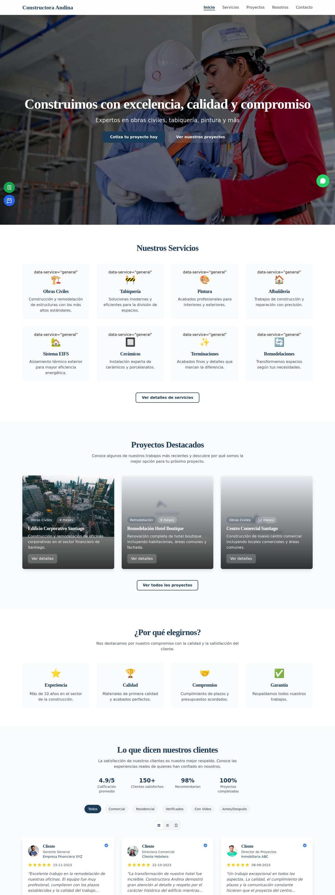
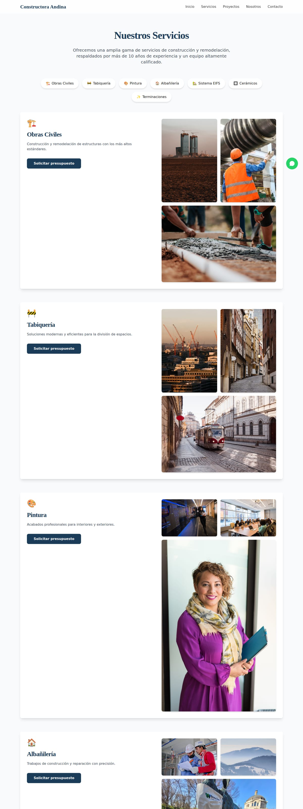
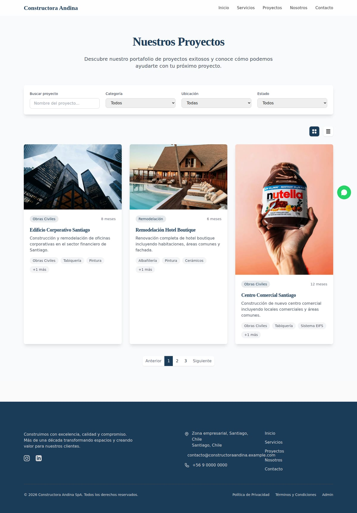
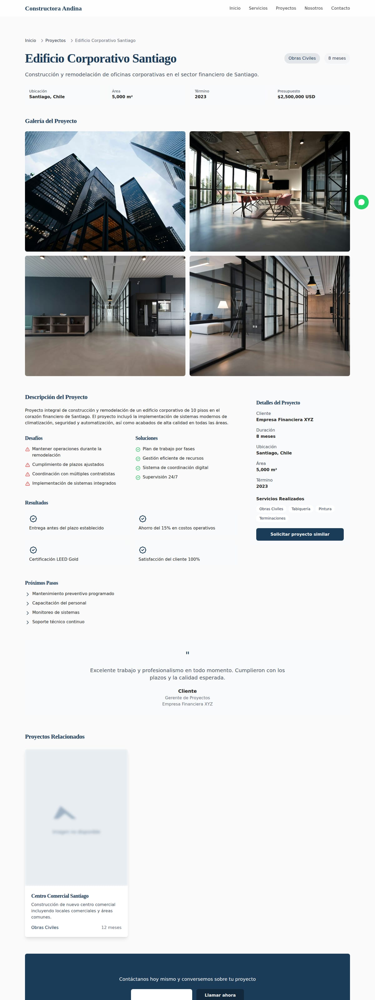
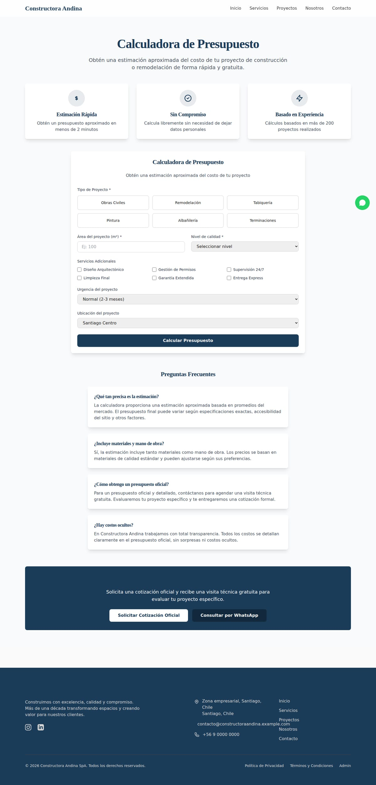
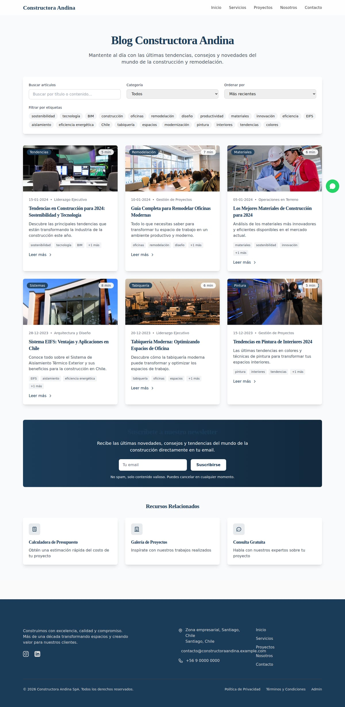
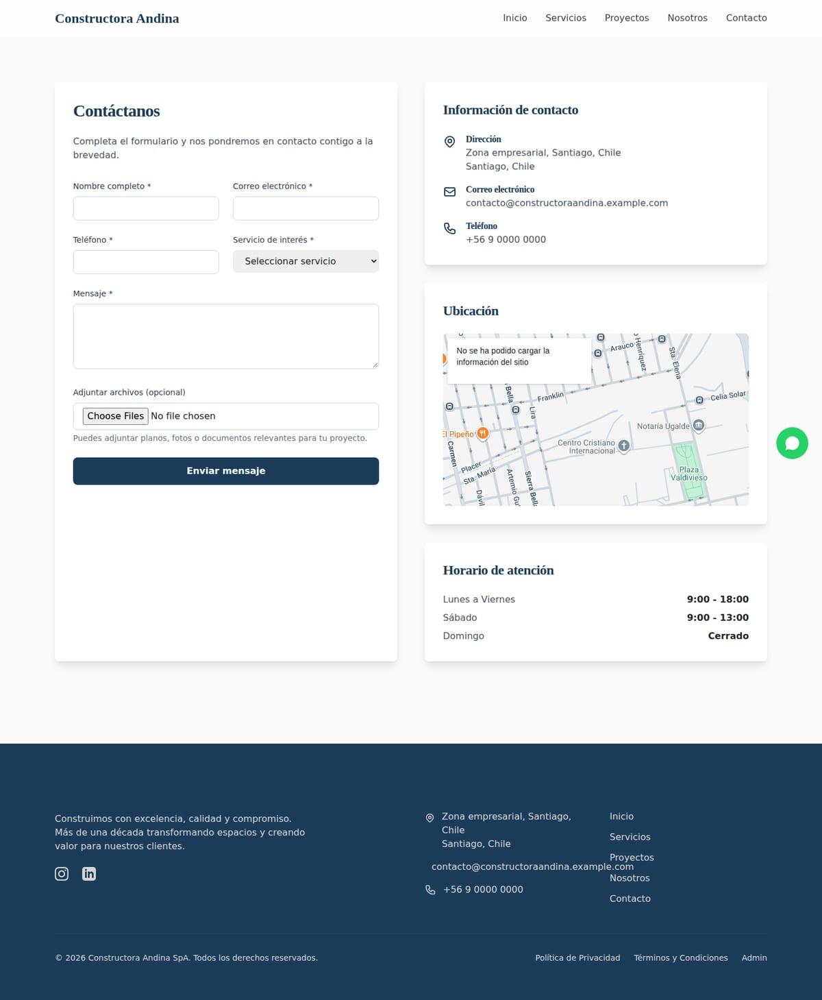
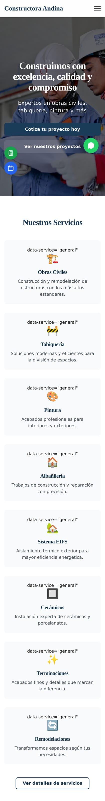
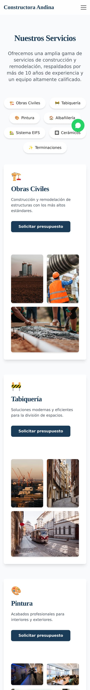
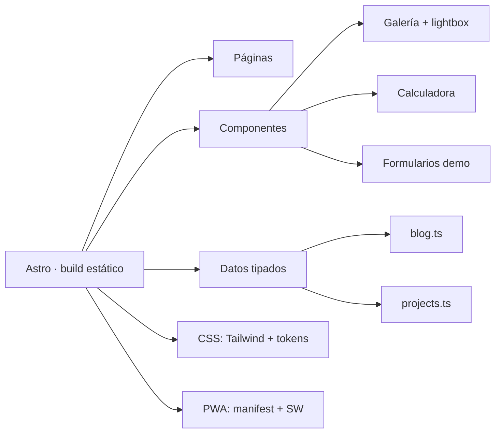

# Constructora Andina — plataforma web corporativa

> Escaparate de un sitio para una empresa de construcción: captación de clientes, portafolio de
> obras, agendamiento, blog y calculadora de presupuesto. Construido con Astro, 100 % estático,
> sin backend.



| | |
|---|---|
| **Tipo** | Sitio corporativo multi-página con área de captación |
| **Stack** | Astro · Tailwind CSS · TypeScript |
| **Páginas** | 24 (12 rutas + detalle dinámico de proyectos y blog) |
| **Estado** | Escaparate funcional, verificado con build y pruebas de humo |
| **Backend** | No incluye: los formularios funcionan en modo demostración |

## Qué resuelve

Una constructora necesita que un cliente potencial encuentre el servicio que busca, vea obras
similares a la suya y pida una cotización **sin fricción**. El sitio cubre ese recorrido completo:

1. **Llega** → portada con propuesta de valor y prueba social.
2. **Entiende la oferta** → 5 servicios con página propia y detalle.
3. **Ve evidencia** → portafolio de proyectos con galería de imágenes y ficha técnica.
4. **Se dimensiona** → calculadora de presupuesto estimado.
5. **Agenda o escribe** → formularios de cita y contacto.
6. **Confía** → blog técnico, páginas legales, información de contacto verificable.

## Capturas

### Portada


### Servicios


### Portafolio de proyectos


### Detalle de proyecto (galería con lightbox)


### Calculadora de presupuesto


### Blog


### Contacto


### Móvil
| Portada | Servicios | Blog |
|---|---|---|
|  |  |  |

## Funcionalidades

- **Navegación multi-página** con rutas limpias y fallback 404 propio.
- **Portafolio dinámico**: cada proyecto tiene ficha con galería, cliente, plazo, superficie,
  servicios ejecutados y resultados.
- **Blog**: listado y artículo con contenido por entrada.
- **Calculadora de presupuesto**: estimación guiada por tipo de obra y superficie.
- **Agendamiento**: formulario por pasos con selección de fecha.
- **Formularios con validación** y estado de carga.
- **PWA**: instalable, iconos propios, service worker.
- **SEO**: metadatos por página, Open Graph, `sitemap.xml`, `robots.txt`, JSON-LD.
- **Accesibilidad**: foco visible, `prefers-reduced-motion` respetado, textos alternativos.
- **Páginas legales**: privacidad y términos.

Detalle técnico en [`docs/ARQUITECTURA.md`](docs/ARQUITECTURA.md) y
[`docs/FUNCIONALIDADES.md`](docs/FUNCIONALIDADES.md).

## Cómo está construido (resumen)



- **Sin JavaScript innecesario**: cada página se envía como HTML; el JS se carga solo donde hace
  falta (galería, calculadora, animaciones).
- **Datos separados de la vista**: el contenido de blog y proyectos vive en módulos tipados, así
  el listado y el detalle comparten una sola fuente.
- **Sistema de diseño propio**: paleta, tipografía y componentes base en un único archivo de
  estilos, no repartidos por página.

## Alcance de esta versión

Es una **vitrina**: demuestra el diseño, la arquitectura y los flujos. No incluye backend, base de
datos ni pasarela de pago. Los formularios validan y confirman, pero no envían datos.

## Créditos de imágenes

Las fotografías son de **Pexels**, bajo su [licencia libre](https://www.pexels.com/license/)
(uso comercial permitido, sin atribución obligatoria). Se incluyen aquí como material de
demostración del escaparate, no como registro de obras reales de la empresa.

## Verificación

```
npm run build   →  24 páginas · sin enlaces internos rotos · todas las páginas cargan CSS
```

Las capturas de `screenshots/` se generan automáticamente con Playwright desde el sitio compilado
(herramienta: `~/AURA/portfolios/_capturas/capturas.mjs <url> <carpeta>`), no son montajes manuales.

## Contacto

Soluciones Industriales Prime JC — [solinprimejc.com](https://solinprimejc.com)
